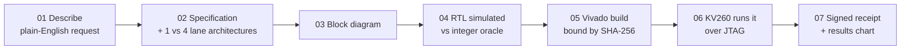

<div align="center">

# SiliconOS

**Reconfigure. Verify. Deploy. Keep the receipt.**

Describe the hardware accelerator you need in plain English. SiliconOS turns it into a reviewed specification, simulates the real RTL, builds it for an AMD Kria KV260 FPGA, runs it on the board over JTAG, and gives you a signed receipt that ties every number back to the exact source, bitstream and inputs.

[](https://cpvc-ai-hackathon-guide.vercel.app/)
[](#team-mission-impromptable)
[](#hardware-setup-kv260)
[](hw/matmul_board/results)
[](#requirements)
[](#requirements)
[](#requirements)
[](LICENSE)

[Quick start](#quick-start) · [Demo walkthrough](#demo-walkthrough) · [Hardware setup](#hardware-setup-kv260) · [How the receipt works](#how-the-receipt-works) · [Troubleshooting](#troubleshooting)

</div>

---

## Built at the CPVC × OCOB × CPE AI Hackathon

SiliconOS was built in one weekend for the **CPVC × OCOB × CPE AI Hackathon**, hosted by CPVC, the **Orfalea College of Business (OCOB)** and **Cal Poly Entrepreneurs (CPE)** at **Cal Poly, San Luis Obispo**, with **OpenAI** as sponsor.

| | |
|---|---|
| **Dates** | Friday, November 13 – Sunday, November 15, 2026 |
| **Location** | Cal Poly, San Luis Obispo · Orfalea College of Business (Bldg 03), Cotchett Education Building (Bldg 02), Frost Center (Bldg 181) |
| **Theme** | *"Build something real people would actually use."* |
| **Rules** | Teams of 2–4 · everything built during the event (build clock started Friday 5:00 PM) · use AI somewhere in the build · be honest about what you made |
| **Format** | 4-minute live demo + 3 minutes of questions, judged by panels with at least one builder and one business judge; room winners pitch again at finals |
| **Prizes** | About $10,000 total: 1st $4,000 · 2nd $2,000 · 3rd $1,000 · three optional $1,000 challenges |

### Team: Mission Impromptable

| Engineer | What they built |
|---|---|
| **[Drew Nakamura](https://github.com/drew-nakamura)** | KV260 bring-up, the Vivado board build, the JTAG board runner, signed result import, the live prompt-to-board pipeline, and demo integration |
| **Chris Sepka** | The matrix-multiply accelerator RTL and AXI wrapper, the web workbench, AI specification drafting, the simulation and verification engine, handoff archives, and the block diagram |

### Judging rubric (100 points)

| Category | Points | Where to look in SiliconOS |
|---|---:|---|
| Execution & design | 25 | The 7-step flow runs from a prompt to measured results on a physical KV260 ([walkthrough](#demo-walkthrough)) |
| Real problem, real user | 25 | [The problem](#the-problem) |
| Path to customers | 20 | [Who it's for](#who-its-for) |
| Pitch & demo | 15 | [Demo walkthrough](#demo-walkthrough) and the [honest labels](#what-the-numbers-mean) we use on stage |
| Creative use of AI | 15 | [Where AI is used](#where-ai-is-used) |

<details>
<summary><b>Full event schedule</b> (Pacific time, from the <a href="https://cpvc-ai-hackathon-guide.vercel.app/">participant guide</a>)</summary>

| Day | Time | Event |
|---|---|---|
| Fri, Nov 13 | 5:00 PM | Build clock starts |
| | 6:00 PM | Opening |
| | 7:05 PM | Pitch Night |
| | 8:50 PM | Teams locked |
| Sat, Nov 14 | 9:15 AM | Check-in; workshops, a talk and open build all day |
| | 2:00 PM | Project link due |
| | 8:00 PM | Sunday commit due |
| | 10:00 PM | Doors lock |
| Sun, Nov 15 | 7:45 AM | Breakfast |
| | 12:00 PM | Submissions close |
| | 1:00–3:00 PM | Room judging |
| | 3:15–3:50 PM | Challenge round |
| | 4:10–5:15 PM | Finals |
| | 5:30–6:00 PM | Awards |

Optional challenges ($1,000 each, one per team): the **OpenAI challenge** ("Build something that helps someone", must use Codex), the **Startup Launch Award** (build for a specific customer and test real demand, judged by Cal Poly Entrepreneurs), and **Best Use of AI** ("Build something that breaks without AI", judged by Cal Poly Vibe Coding). The guide notes that newer instructions on the event Discord take precedence.

</details>

### AI tools we used

| Where | Tool | What for |
|---|---|---|
| Building SiliconOS | OpenAI Codex, Claude Code, Cursor, Kiro | Coding agents for the app, RTL, Vivado/JTAG scripts, tests and docs. We checked their work with tests, simulation and the physical board rather than taking the model's word for it. |
| Inside the product | Groq API running `openai/gpt-oss-20b` | Turns a plain-English request into a structured accelerator specification (strict JSON schema, validated on the server) |

---

## The problem

An edge-hardware team rarely ships one perfect FPGA configuration. Different devices need different throughput and capacity. Changing a parameter is easy. **Proving the new variant is correct, and tracking exactly which source, build and bitstream ended up on which board, is the expensive part.** Today that evidence lives in scattered Vivado logs, screenshots and memory.

SiliconOS keeps that chain intact. Every step records SHA-256 hashes, and the board result is only accepted if it matches the source that was simulated and the bitstream that was built.

## Who it's for

The first user is an **edge-hardware / FPGA engineer** who already reads timing and utilization reports and wants to compare accelerator variants without losing track of what was deployed. Customer demand, the buyer and time savings are still hypotheses we are testing, not validated results.

## What it does



The supported workload is **signed INT8 matrix multiplication with INT32 accumulation** (sizes 8×8 and 16×16) in two architectures: a **1-lane** sequential multiply-accumulate unit and a **4-lane** parallel array. Both 8×8 designs have prebuilt KV260 bitstreams in this repository.

### Measured on a real KV260

| | 1 lane | 4 lanes |
|---|---:|---:|
| Cycles, **measured** by the on-chip counter | **512** | **128** |
| Kernel time at 100 MHz (calculated) | 5.12 µs | 1.28 µs |
| Outputs correct (first run, repeat, after reset) | 64 / 64 each | 64 / 64 each |
| LUTs / flip-flops (`matmul_axi`, post-route) | 354 / 318 | 3,612 / 2,470 |
| DSP / BRAM | 0 / 0 | 0 / 0 |
| Worst setup slack / Fmax estimate | 4.757 ns / 190.7 MHz | 3.885 ns / 163.5 MHz |
| Total on-chip power (Vivado **estimate**) | 2.723 W | 2.736 W |
| Passing board runs committed | 7 | 7 |

Four lanes take **4× fewer cycles for about 10× the LUTs**. That is extra arithmetic capacity, not free speed. All 14 board results are in [`hw/matmul_board/results/`](hw/matmul_board/results), and 12 of them are linked to the app run that produced their inputs.

---

## Requirements

SiliconOS runs on **Windows 10 or 11**. The board tools (AMD Vivado and xsdb) do not run on macOS, and the board scripts expect a Windows install.

What you need depends on how far you want to go:

| To do this | You need |
|---|---|
| Run the app, simulate both designs, export handoff ZIPs, browse the Vivado evidence (steps 01–05) | [Git](https://git-scm.com/download/win), [Python 3.10+](https://www.python.org/downloads/windows/) (tested on 3.14), [Icarus Verilog 12](https://bleyer.org/icarus/) |
| Draft the specification from a plain-English prompt with AI | A [Groq API key](https://console.groq.com/keys) |
| Run on real hardware (steps 06–07) | [AMD Vivado 2025.2](https://www.amd.com/en/products/software/adaptive-socs-and-fpgas/vivado.html) installed at the **default path** `C:\AMDDesignTools\2025.2`, an **AMD Kria KV260 Vision AI Starter Kit**, its 12 V supply and a micro-USB data cable, and a runner signing key ([setup](#hardware-setup-kv260)) |
| Rebuild the bitstreams yourself | Vivado 2025.2 with Zynq UltraScale+ MPSoC device support (the KV260 board files ship with it) and about 15–20 minutes per configuration |
| Run the UI tests | [Node.js 18+](https://nodejs.org/) |

No `pip install` is needed: the server uses only the Python standard library.

## Quick start

Open **PowerShell** and run:

```powershell
# 1. Install the tools (skip any you already have)
winget install --id Git.Git -e
winget install --id Python.Python.3.14 -e
winget install --id Icarus.Verilog -e

# 2. Close PowerShell and open a NEW window so PATH updates, then check:
python --version
iverilog -V

# 3. Get the code and start the app
git clone https://github.com/drew-nakamura/SiliconOS.git
cd SiliconOS
python server.py
```

Open **http://127.0.0.1:8000**, click **Use the example · no AI**, then **▶ Build it and run it on the KV260**.

Without a board, steps 01–05 run live on your machine. Step 06 then reports that no USB-JTAG cable was found. That is expected. The measured board results are committed in [`hw/matmul_board/results/`](hw/matmul_board/results) for you to inspect.

> [!TIP]
> If `python` opens the Microsoft Store or is not found, use the Python launcher instead: `py server.py`.
> If `iverilog` is not found, add Icarus to your PATH and open a new terminal:
> ```powershell
> [Environment]::SetEnvironmentVariable('Path', [Environment]::GetEnvironmentVariable('Path','User') + ';C:\iverilog\bin', 'User')
> ```

> [!IMPORTANT]
> Use `git clone`, and don't re-save files in `hardware/` or `hw/matmul_board/`. The bitstreams are bound to the exact bytes of the RTL. [`.gitattributes`](.gitattributes) stops Git from converting line endings there, and a single changed byte makes the board runner refuse to run.

## Turn on AI drafting (optional)

The app works without AI: the built-in example and the editable specification cover the whole flow. To draft the specification from a prompt, store a Groq key as a Windows user environment variable:

```powershell
[Environment]::SetEnvironmentVariable('GROQ_API_KEY', (Read-Host 'Paste your Groq API key'), 'User')
[Environment]::SetEnvironmentVariable('GROQ_MODEL', 'openai/gpt-oss-20b', 'User')
```

Then **open a new terminal** (or restart VS Code if you use its terminal) and start `python server.py` again. The page shows `AI: Groq · openai/gpt-oss-20b configured`. The key stays on the server; it never reaches the browser or Git. `.env` files are **not** loaded automatically; [`.env.example`](.env.example) lists the settings only.

The free Groq tier rate-limits quickly. Wait about a minute between **Generate specification** clicks.

---

## Hardware setup (KV260)

You need this only to run steps 06–07 on a physical board.

### 1. Install Vivado 2025.2

- Install **AMD Vivado 2025.2** to the **default location**, `C:\AMDDesignTools\2025.2`. The runner calls `C:\AMDDesignTools\2025.2\Vivado\bin\xsdb.bat` directly.
- Include **Zynq UltraScale+ MPSoC** device support and leave **Install Cable Drivers** checked.
- If you skipped the cable drivers, run this in an **Administrator** PowerShell:
  ```powershell
  & 'C:\AMDDesignTools\2025.2\Vivado\data\xicom\cable_drivers\nt64\install_drivers.cmd'
  ```

### 2. Create the runner signing key

The board runner and the app share an HMAC key, so the app only accepts results produced by your runner. Generate one without printing it:

```powershell
$bytes = New-Object byte[] 32
[System.Security.Cryptography.RandomNumberGenerator]::Create().GetBytes($bytes)
$hex = -join ($bytes | ForEach-Object { $_.ToString('x2') })
[Environment]::SetEnvironmentVariable('SILICONOS_RUNNER_KEY', $hex, 'User')
[Environment]::SetEnvironmentVariable('SILICONOS_RUNNER_KEY_ID', 'my-kv260-laptop', 'User')
Remove-Variable hex, bytes
```

Open a new terminal afterwards. Never commit or share this key.

### 3. Connect the board

| Connection | Port |
|---|---|
| Micro-USB **data** cable (JTAG + UART) to your PC | **J4** |
| 12 V power supply | **J12** |
| SD card | **Remove it.** The runner boots the board in JTAG mode. |

Close any open **Vivado Hardware Manager** session (it holds the cable). Then, from the repository root:

```powershell
python hw/matmul_board/run_board.py --check
```

You should see `BOARD_CHECK: OK`. This check is read-only: it lists the JTAG chain and does not reset or program anything.

---

## Demo walkthrough

Start the app from a new terminal in the repository root:

```powershell
python server.py
```

Then open **http://127.0.0.1:8000**.

| Step | What you do | What you see |
|---|---|---|
| **01 Describe what you need** | Type a request, e.g. *"A fast 8×8 INT8 matrix multiply on my KV260, up to 4 lanes, 100 MHz"*, and click **Generate specification**. No AI key? Click **Use the example · no AI**. | The AI status line says whether Groq is configured |
| **02 Specification & architecture** | Review the spec. | The spec with the source of each field, plus the two architectures, 1-lane vs 4-lane, each marked "KV260 bitstream ready". Nothing has run yet. |
| **03 Block diagram** | Toggle 1 lane / 4 lanes. Click **▶ Build it and run it on the KV260**. | The data path, plus the real board integration: Zynq PS → AXI4-Lite → `matmul_axi` at `0xA0000000`, ~100 MHz. |
| **04 RTL verified and packaged** | (automatic) | `matmul.sv` simulated in Icarus, all 64 outputs checked against an independent Python integer model, and the handoff ZIP with file hashes |
| **05 Vivado implementation complete** | (automatic) | The bitstream built from **this exact RTL**: timing slack, Fmax, LUT/FF/DSP/BRAM, the power estimate, DRC, and links to every hash-checked report |
| **06 The KV260 responds** | (automatic, board required) | The JTAG chain (cable, `xck26` FPGA, ARM debug port). Then, per design: measured cycles, 64/64 outputs, the repeat and reset checks, a transcript excerpt, and the signed import |
| **07 Results: 1 lane vs 4 lanes** | | 4.00× fewer cycles for 10.2× the LUTs, a comparison chart and the full table |

The whole build-and-run takes about 40–60 seconds. **Run history & tools** at the bottom of the page holds past runs, manual simulation and **Show the last recorded run**. That view always labels runs as recorded, and it shows runs saved by your own local server.

> [!NOTE]
> The bitstreams were built ahead of time (about 10 minutes each in Vivado) and are **reused** because the RTL's SHA-256 matches. Vivado does not run live. Only 8×8 designs run on the board; 16×16 stops after simulation because it has no bitstream.

### Terminal fallback (same tools, by hand)

```powershell
# 1. Board present?
python hw/matmul_board/run_board.py --check

# 2. In the app, run a design, then click "↓ FPGA handoff ZIP" on its result card. Then:
python hw/matmul_board/run_board.py --handoff "$env:USERPROFILE\Downloads\siliconos-<run-id>-n8-l1-handoff.zip"
#    -> MATMUL_BOARD_RESULT: PASS hw\matmul_board\results\<result-folder>

# 3. Verify, sign and import the result into the running app
python hw/matmul_board/sign_result.py hw/matmul_board/results/<result-folder>
#    -> IMPORT: OK board run ... 512 cycles, 64 outputs verified
```

The full rehearsal script, with what to say at each step, is in [`hw/matmul_board/DEMO_RUNBOOK.md`](hw/matmul_board/DEMO_RUNBOOK.md).

---

## How the receipt works

A board number is shown only if every link in this chain holds:

1. **Source.** The app records the SHA-256 of the exact `matmul.sv` it simulated and stores the inputs, the expected outputs and the simulator version.
2. **Handoff.** The exported ZIP carries a manifest that hashes every file inside it.
3. **Build.** [`build.py`](hw/matmul_board/build.py) refuses to build if the RTL hash changed. It accepts a build only if post-route timing is met with no negative slack and DRC has no errors, and it writes `implementation_manifest.json` with the bitstream hash.
4. **Board run.** [`run_board.py`](hw/matmul_board/run_board.py) refuses to program the board unless the ZIP's RTL is byte-identical to the bitstream's RTL and every manifest hash matches. It runs the job three times (first run, repeat, and after a PL reset). It checks every output against its own Python reference and the cycle count against N³ / LANES. xsdb only reports raw register readings; all pass/fail decisions are made in Python.
5. **Signature.** [`sign_result.py`](hw/matmul_board/sign_result.py) re-hashes the `.bit`, the reports and the manifest, then signs the result with HMAC-SHA256.
6. **Import.** The app checks the signature, the parent run, the input hash and the source hashes before it stores the result as a `board_measured` child of the original run.

Failed runs are recorded too. A result folder is never edited after it is written.

### What the numbers mean

- **Measured on the KV260:** cycle counts come from the accelerator's counter on the chip, and every output was checked against the app's own reference.
- **Calculated:** kernel time is cycles ÷ the configured 100 MHz clock (`pl_clk0` is 99,999,001 Hz; the board clock is not measured). The JTAG transfer takes seconds and is not accelerator speed.
- **Estimated:** power and Fmax come from Vivado reports, not measurements.
- **Recorded:** a run replayed from history is always labelled as recorded, with its run ID.

## Where AI is used

- **Specification drafting.** A plain-English request becomes a structured spec through Groq's strict JSON-schema output. The server validates every field, and the UI shows which fields came from the AI so the engineer can review them before anything runs.
- **Development.** The team built SiliconOS with coding agents (see [AI tools we used](#ai-tools-we-used)), with simulation and the physical board as the referee.
- **Not in the demo: AI-written RTL.** The app has a **Generate & verify RTL** path that asks the model for new SystemVerilog and accepts it only if it passes the unchanged testbench, the integer oracle and an independent cycle monitor. It is hidden in the demo because current models have not yet passed that gate, and AI-written RTL has no bitstream. We kept the gate strict rather than relaxing it. See [`docs/AI_RTL_GENERATION.md`](docs/AI_RTL_GENERATION.md).

---

## Running the tests

From the repository root:

```powershell
python -B -m unittest discover -s tests            # 63 app tests, ~80 s (needs Icarus Verilog)
python -B hw/matmul_board/tests/test_run_board.py  # 21 runner tests; the xsdb mock-board cases need Vivado
python -B hw/tools/test_vivado_summary.py          # 7 report-parser tests
node tests/test_web.js                             # 24 UI tests (needs Node.js 18+)
```

On November 15, 2026, a fresh `git clone` of this code on Windows 11 (Python 3.14, Icarus Verilog 12, Vivado 2025.2, Node 24) passed all four suites. The runner tests include deliberate fault cases (wrong outputs, timeouts, bad IDs, reset not cleared); their `FAIL` lines are expected.

## Rebuilding the bitstreams

You don't need to: the built `.bit`, `.xsa`, reports and manifests are committed. To rebuild:

```powershell
python hw/matmul_board/build.py --lanes 1    # ~15-20 min -> hw/matmul_board/build/n8_l1/
python hw/matmul_board/build.py --lanes 4    # -> hw/matmul_board/build/n8_l4/
python hw/matmul_board/build.py --compare    # writes build/compare_n8/summary.md
```

`--handoff <zip>` builds from the RTL inside an app handoff ZIP instead. A rebuild may produce a new bitstream hash (the header holds a timestamp); the manifest records whichever one was actually built. Details: [`hw/matmul_board/README.md`](hw/matmul_board/README.md).

## API reference

The server binds to `127.0.0.1` only. It is a local development server, not a public deployment.

| Method | Endpoint | Purpose |
|---|---|---|
| `GET` | `/api/status` | AI, simulator and board availability |
| `POST` | `/api/spec` | Draft a specification from a prompt (AI) |
| `POST` | `/api/explore` | Compare the 1-lane and 4-lane architectures for a spec |
| `POST` | `/api/plan` | Deterministic build recipe (blocks, parameters, source hashes) |
| `POST` | `/api/simulate` | Simulate the RTL for a spec and lane count |
| `GET` | `/api/runs`, `/api/runs/<id>` | Run history and one run's record |
| `GET` | `/api/runs/<id>/handoff.zip` | Portable, hash-manifested handoff archive |
| `GET` | `/api/fpga/builds`, `/api/fpga/builds/<1\|4>/reports/<name>` | Vivado build evidence and hash-checked reports |
| `POST` | `/api/board/check` | Read-only JTAG presence check |
| `POST` | `/api/runs/<id>/board-run` | Run a simulated design on the KV260 (background job) |
| `GET` | `/api/board/jobs/<id>` | Board job progress |
| `POST` | `/api/runs/<id>/board-result` | Import a signed board result |

## Repository layout

```text
SiliconOS/
├── server.py                 # local web server + JSON API (Python standard library only)
├── siliconos/                # spec validation, simulation + oracle, AI, catalog, handoff, board import
├── web/                      # the step-by-step workbench (plain HTML, CSS and JavaScript)
├── hardware/                 # matmul.sv, matmul_axi.sv, testbenches, vendored skid buffer
├── hw/
│   ├── matmul_board/         # KV260 Vivado build, JTAG runner, signer, bitstreams, board results
│   ├── bringup/              # first KV260 bring-up design (PL register readback over JTAG)
│   └── tools/                # Vivado report collector and summarizer
├── data/handoff_exports/     # two app handoff ZIPs used by the board-import tests
├── tests/                    # Python and UI test suites
└── docs/                     # design notes written during the event
```

Some notes in `docs/` describe paths we later removed from the demo, such as a custom-ASIC target. The hardware docs in `hw/` are current.

---

## Troubleshooting

| Symptom | Fix |
|---|---|
| `python` opens the Microsoft Store | Use `py` instead of `python`, or turn off the `python.exe` App Execution Alias in Windows Settings. |
| "Icarus Verilog is unavailable" | Open a new terminal so PATH updates, or add `C:\iverilog\bin` to PATH ([command above](#quick-start)). |
| AI shows "not configured" | Set `GROQ_API_KEY` and `GROQ_MODEL`, then start the server from a **new** terminal. |
| AI request fails or is rate-limited | Wait a minute and retry. We saw intermittent failures on campus Wi-Fi that went away on a phone hotspot. Or click **Use the example · no AI**. |
| Step 05 says "not built from this RTL" | A file in `hardware/` changed or got CRLF line endings. Re-clone, or run `git checkout -- hardware`. |
| Step 06 "USB-JTAG cable not found" | Plug the micro-USB cable into **J4**, close Vivado Hardware Manager, and build again. |
| Step 06 finds the cable but no FPGA | Check 12 V power on **J12** and power-cycle the board. |
| `xsdb did not complete` | Vivado 2025.2 is not at `C:\AMDDesignTools\2025.2`. Install it there, or edit `XSDB` near the top of `hw/matmul_board/run_board.py`. |
| "another board run holds … .runner.lock" | If no run is active: `Remove-Item hw\matmul_board\results\.runner.lock` |
| Import fails "not configured" | `SILICONOS_RUNNER_KEY` / `SILICONOS_RUNNER_KEY_ID` are missing in the server's environment. Set them, then start the server from a new terminal. |
| Port 8000 is busy | `$env:PORT = 8001; python server.py` |

## Limitations

- **One workload.** Signed INT8 → INT32 matrix multiplication. Only the 8×8 1-lane and 4-lane designs have bitstreams; 16×16 is simulation only.
- **Prebuilt bitstreams.** Vivado does not run during the demo (about 10 minutes per configuration).
- **Measured vs. estimated.** Cycles and outputs are measured on the board. Kernel time is calculated, and power and Fmax are Vivado estimates. The 8×8 multiplies map to LUTs, not DSPs.
- **One board.** The runner targets the KV260 over JTAG from a Windows PC. There is no Linux image on the board, no fleet or over-the-air deployment, and no support for other boards yet.
- **Local only.** The server binds to `127.0.0.1` and is not hardened for public hosting.
- **AI scope.** AI drafts the specification. The RTL that runs on the board is the checked-in, human-reviewed design.

## Further reading

- [`hw/matmul_board/README.md`](hw/matmul_board/README.md): board design, register map, build and runner details
- [`hw/matmul_board/DEMO_RUNBOOK.md`](hw/matmul_board/DEMO_RUNBOOK.md): demo rehearsal script and talking points
- [`hw/matmul_board/APP_SIDE_UPDATE.md`](hw/matmul_board/APP_SIDE_UPDATE.md): the board-result contract the app imports
- [`hw/bringup/README.md`](hw/bringup/README.md): first KV260 bring-up
- [`docs/AI_RTL_GENERATION.md`](docs/AI_RTL_GENERATION.md): the AI RTL generation gate and replay

## Credits and license

- **Icarus Verilog** (GPL) is an external simulator. **AMD Vivado** and **xsdb** are external proprietary tools. Neither is included here.
- **Groq** provides the optional AI specification drafting.
- [`hardware/vendor/wb2axip/skidbuffer.v`](hardware/vendor/wb2axip) is an unmodified ZipCPU utility under its Apache-2.0 license. It is qualified by a local test and is **not** part of the matrix data path.
- DM Sans and Space Grotesk are loaded from Google Fonts.
- No third-party accelerator RTL is included.

SiliconOS is released under the [MIT License](LICENSE). Built by **Mission Impromptable** at the CPVC × OCOB × CPE AI Hackathon, Cal Poly, San Luis Obispo, November 2026.
